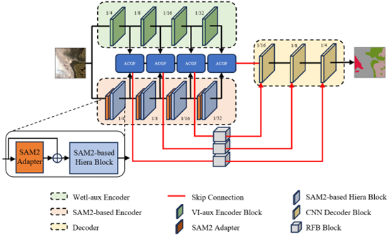

# Wetl-SAM2YNet

## Introduction

Wetl-SAM2YNet is a dual-branch semantic segmentation network for fine-scale marsh wetland mapping from high-resolution multispectral remote sensing imagery. It combines visual features from a SAM2 Hiera encoder with wetland-sensitive spectral features and integrates them through the Adaptive Cross-Gated Fusion (ACGF) module.



## Requirements

Create a Python environment and install the required packages from `requirement.txt`:

```bash
conda create -n wetl-sam2ynet python=3.10
conda activate wetl-sam2ynet
pip install -r requirement.txt
```

This project uses the original **SAM 2**, not SAM 2.1 or later variants. Download and configure SAM 2 and its pretrained checkpoint according to the [Meta SAM 2 official repository](https://github.com/facebookresearch/sam2). Other SAM 2 model variants may be used by downloading the corresponding checkpoint and adapting the related configuration and network code.

We thank Meta AI and the SAM 2 contributors for making the official implementation, configurations, and pretrained checkpoints publicly available.

## Dataset

Organize the training and test data into separate image and label directories:

```text
img_datas/
|-- train/
|   |-- image/
|   `-- label/
`-- test/
    |-- image/
    `-- label/
```

Input images should be four-band GeoTIFF files with bands ordered as `B`, `G`, `R`, and `NIR`. Labels should be single-band GeoTIFF files spatially aligned with the corresponding images. Each `*_image.tif` file must have a matching `*_label.tif` file. Class definitions, label encoding, normalization, and preprocessing should be adjusted in the relevant code when using a new dataset.

## Training

Prepare the dataset and SAM 2 checkpoint, configure the paths and training options defined in `train.py`, and run:

```bash
python train.py
```

The trained model and training log are saved to the configured output directory.

## Testing

Configure the model path, dataset paths, and output directory through the arguments defined in `test.py`, and run:

```bash
python test.py
```

The script reports the segmentation metrics and saves the prediction results to the configured output directory.

## Large-scene inference

Set the model path, input directory, output directory, and mapping options at the beginning of `inference_map.py`, then run:

```bash
python inference_map.py
```

The script processes full-size multispectral GeoTIFF scenes and writes the resulting classification maps to the configured output directory.
